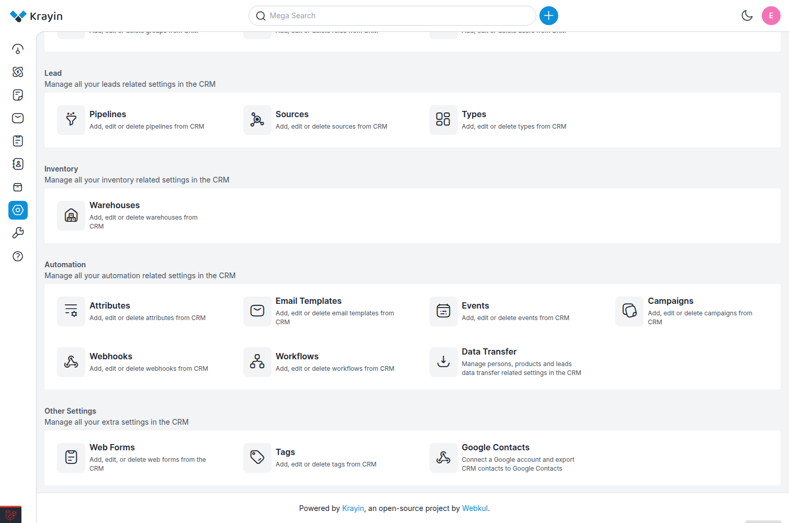
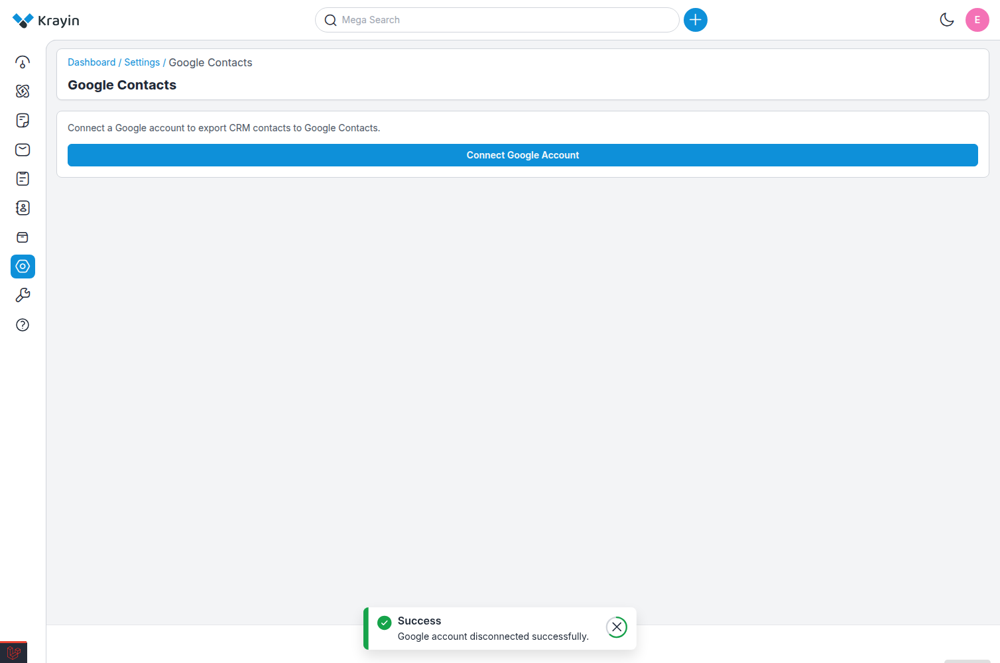
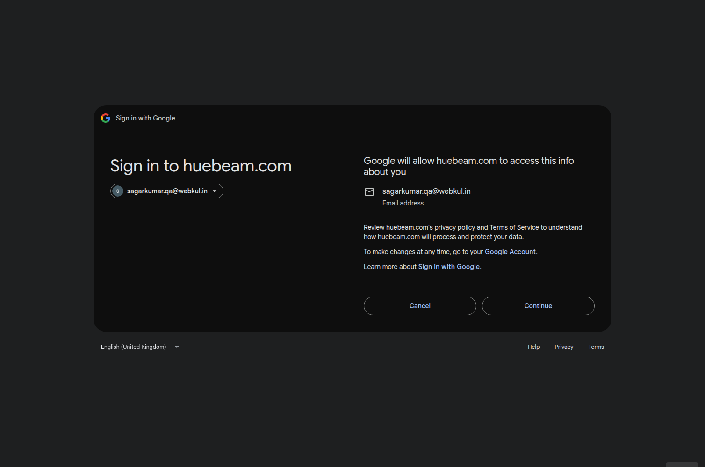
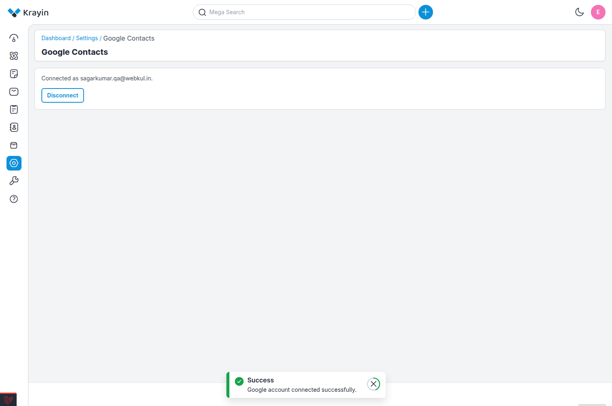
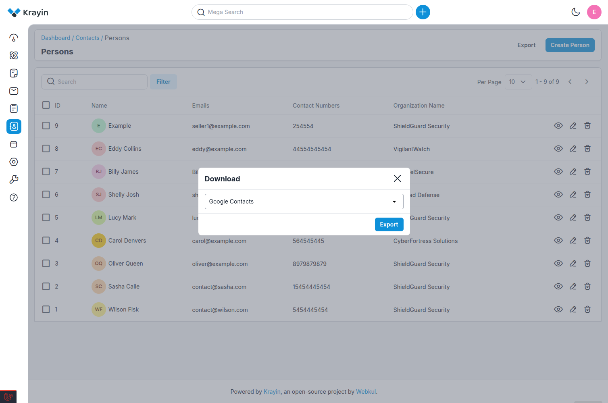
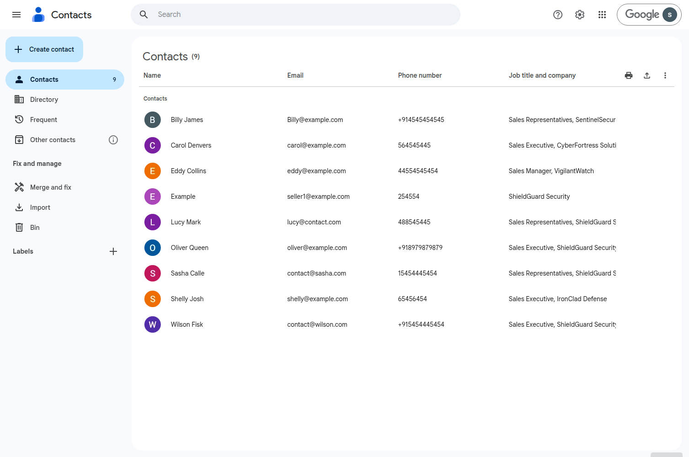

# Google Contacts

The **Google Contacts** integration in Krayin CRM allows you to connect your Google account and export CRM persons directly to **Google Contacts**. Once connected, you can push persons from the Contacts module into your Google account with a single click, while the export runs asynchronously in the background.

---

## Prerequisites

Install the Google API PHP Client by running the following command:

```bash
composer require google/apiclient
```

Run the below command to create the required database tables for the Google Contacts feature.

```bash
php artisan migrate
```

## Google Cloud Configuration

Before connecting your Google account, you must configure a Google Cloud project and create OAuth credentials.

### Step-1: Create or Select a Google Cloud Project

* Open the **Google Cloud Console**.
* Create a new project or select an existing project.

### Step-2: Enable the People API

* Navigate to **APIs & Services >> Library**.
* Search for **People API**.
* Click **Enable**.

### Step-3: Configure the OAuth Consent Screen

* Navigate to **APIs & Services >> OAuth consent screen**.
* Configure the consent screen by providing the required application details.
* Add the following OAuth scope:

```text
https://www.googleapis.com/auth/contacts
```

### Step-4: Create OAuth 2.0 Credentials

* Navigate to **APIs & Services >> Credentials**.
* Click **Create Credentials >> OAuth Client ID**.
* Select **Web application** as the application type.
* Add the following Authorized Redirect URI (replace the domain with your application URL):

```text
https://your-domain.com/admin/settings/google-contacts/callback
```

### Step-5: Configure Environment Variables

Add the following variables to your application's `.env` file:

```env
GOOGLE_CLIENT_ID=your_google_client_id
GOOGLE_CLIENT_SECRET=your_google_client_secret
GOOGLE_REDIRECT_URI=https://your-domain.com/admin/settings/google-contacts/callback
```

After updating the `.env` file, clear the application configuration cache:

```bash
php artisan config:clear
php artisan cache:clear
```

---

## Connect Google Account

**Step-1** Go to the admin panel of Krayin and click on **Settings >> Other Settings >> Google Contacts** as shown in the below image.



**Step-2** Click on the **Connect Google Account** button as shown in the below image.



**Step-3** You will be redirected to Google's consent screen. Sign in with the Google account you want to connect and click on **Allow** to grant the required permissions.



**Step-4** Once the permission is granted, you will be redirected back to the Krayin admin panel along with a success message. The page now shows the connected Google account details and a **Disconnect** button as shown in the below image.



> ✅ After connecting, the **Google Contacts** option becomes available in the **Export** modal of the Persons data grid.

---

## Export Persons to Google Contacts

**Step-1** Go to the admin panel of Krayin and click on **Contacts >> Persons**.

**Step-2** Click on the **Export** button.

**Step-3** From the **Format** dropdown, select **Google Contacts** and click on the **Export** button as shown in the below image.



**Step-4** An **Export started** toast appears immediately and the export continues in the background. The export modal shows the live progress with the following counts:

* **Total**
* **Exported**
* **Duplicate**
* **Failed**

**Step-5** Once the batch finishes, a summary toast appears, for example:

> *"Export finished: X exported, Y already existed, Z failed."*

**Step-6** Open **contacts.google.com** and sign in with the connected Google account to verify the exported contacts as shown in the below image.



### Duplicate Handling

If you run the export again on the same persons, the contacts already present in your Google account are reported as **duplicates** instead of being created again.

---

## Disconnect Google Account

**Step-1** Go to the admin panel of Krayin and click on **Settings >> Other Settings >> Google Contacts**.

**Step-2** Click on the **Disconnect** button to remove the connected Google account as shown in the below image.


> ✅ Once disconnected, the **Google Contacts** option is no longer available in the Export modal.

---

## Notes

* The export runs asynchronously, so you can continue working while the batch is being processed.
* Only persons matching the current filters and sorting applied to the data grid are exported.
* A Google account must be connected before you can export persons to Google Contacts.
* Ensure that the **People API** is enabled and the OAuth credentials are configured correctly before attempting to connect your Google account.

By following the above steps, you can configure Google Cloud, connect your Google account, and export Krayin CRM persons to Google Contacts successfully.
